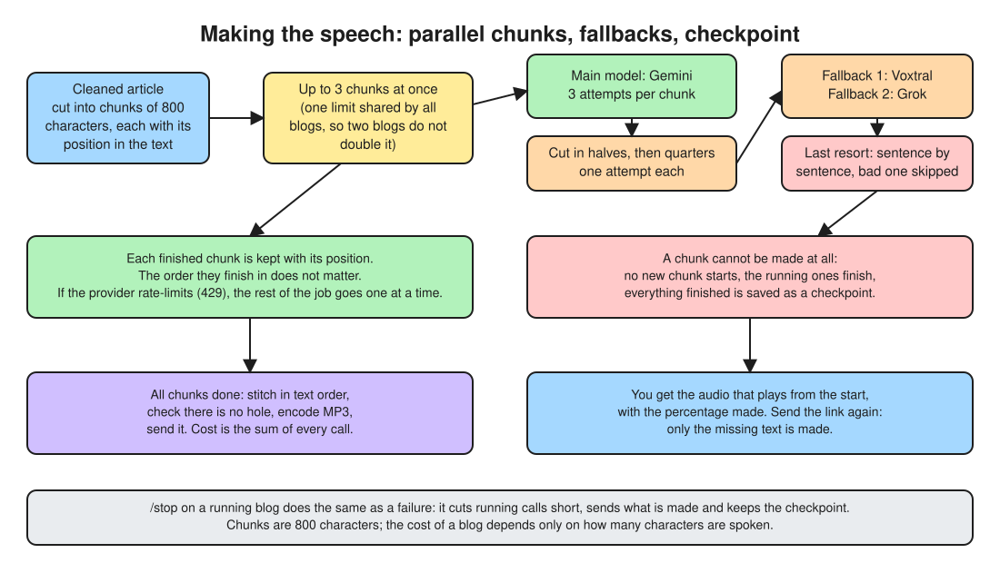
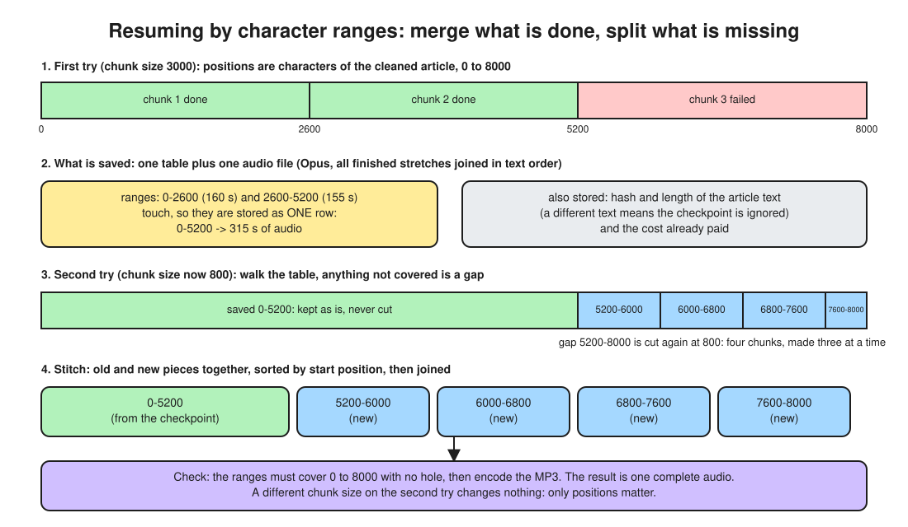

# sevi
- sevi is my extendable audio blog setup that I built to help me listen to blogs and interact with blogs online on the fly.
- I have lot of blogs to read but too little fixed time. so a flexible straightforward audio blog version of blog which can be cross questioned, debated and explore the tangents around the blog completely in audio format is what I wanted right now. so I built one.
- currently I extended sevi core with telegram interface coz it is easy for me to interact with telegram. it can be anything  whatsapp,discord,custom webpage. (custom webpage will be built for v1 for more fine grain features and usability)
- here is a quick demo of v1: https://drive.google.com/file/d/14Tp5XqHrz5HLR4dpEJ6m3DaxumOK2rU8/view?usp=sharing

- the overall infra can be lot simpler but Ive specifically designed it this way because none of it cost money, I took a bunch of primitives which have insanely high free limit and stritched them together which is fast and secure (I clearly understand the tradeoff but this is something personal that I use everyday so I am okay with it)

# Design (deployed version)

## 1. The big picture

## 2. A message's path, and who gets stopped on the way

## 3. Blog link to audio

## 4. When speech fails

Chunks of the article (800 characters each) are spoken three at a time (`models.tts.concurrency`, shared by every job, so two blogs at once do not double it); the results are stitched together in text order. Each chunk is tried on the main voice model with `models.tts.retries` extra attempts, then cut into halves and quarters tried once each, then sent to the fallback models, and as a last resort spoken sentence by sentence. After two chunks in a row fail on the main model it is skipped for 10 minutes.

When a chunk cannot be made, nothing new is started, the chunks already running finish, and everything finished is saved as one compressed checkpoint. You get the audio that plays from the start of the article. Sending the link again makes only what is missing. Reply `/stop` to a blog that is still being made to cut it short: it sends the audio made so far and keeps the checkpoint.

### How a half-done blog is resumed

Everything is keyed by **character positions in the cleaned article**, not by chunk number or by time, because chunk numbers change with the chunk size and time depends on the voice. Every chunk is a range `[start, end)` and the ranges of one run tile the text with no holes.

Worked example, an 8000-character article:

1. **First try, 3 chunks of about 3000.** Chunks `0-2600` (160 s of audio) and `2600-5200` (155 s) finish. Chunk `5200-8000` fails.
2. **Merge and save.** The two finished ranges touch (2600 is both an end and a start), so they are stored as one row: `0-5200 -> 315 s`. The checkpoint is a single object: that table (plus a hash and the length of the text, and the cost so far) and the audio of all finished ranges, joined in text order and compressed.
3. **Find the gaps.** On the next try the table is sorted and the text is walked from 0 to 8000. What is not covered is a gap: here `5200-8000`. (Had `0-2600` and `4000-5200` been done, the gaps would be `2600-4000` and `5200-8000`.)
4. **Split again, at today's size.** Each gap is chunked on its own with the current `chunk_chars`. With 800 that is `5200-6000`, `6000-6800`, `6800-7600`, `7600-8000`. The old ranges end at sentence boundaries, so new chunks never cut across audio that already exists.
5. **Cut the saved audio back into ranges** using the milliseconds in the table (24 kHz, 16-bit: 48 bytes per millisecond). A merged row such as `0-5200` is never cut; it is only placed.
6. **Stitch.** Old and new pieces go in one list sorted by start position and are joined. Before the MP3 is made it checks that the ranges cover `0-8000` with no hole; if not, the job fails instead of delivering audio with a gap.

Because only positions matter, changing `chunk_chars` between tries loses nothing. A checkpoint is ignored (and the blog starts over) only if the article text itself differs, or if it was written by an older version of the app. Compression can move a range boundary by a few milliseconds; boundaries sit between sentences, in silence.

## 5. Follow-up questions, by voice or text

## 6. Sleeping when idle

A cold start takes about 2 s, so the instance does not stay warm: it exits 30 s after a blog is delivered, and follow-up answers keep it up 1 to 2 minutes. A running job (audio generation can take many minutes) always finishes first; the window only starts counting once it ends.

## 7. Where data lives, and how long

## 8. Deploying

