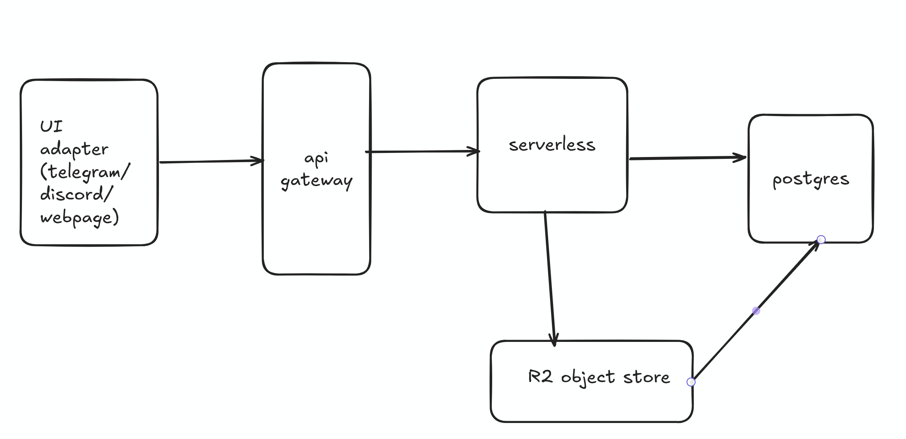
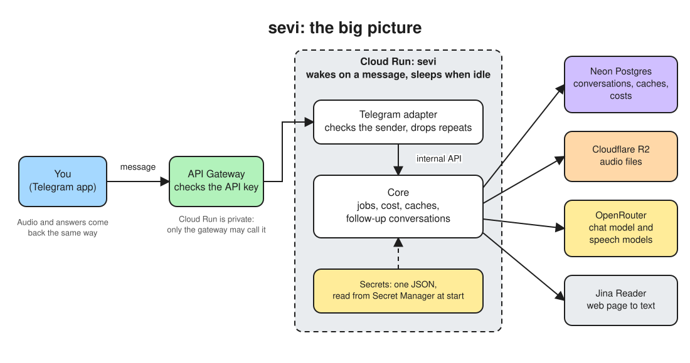
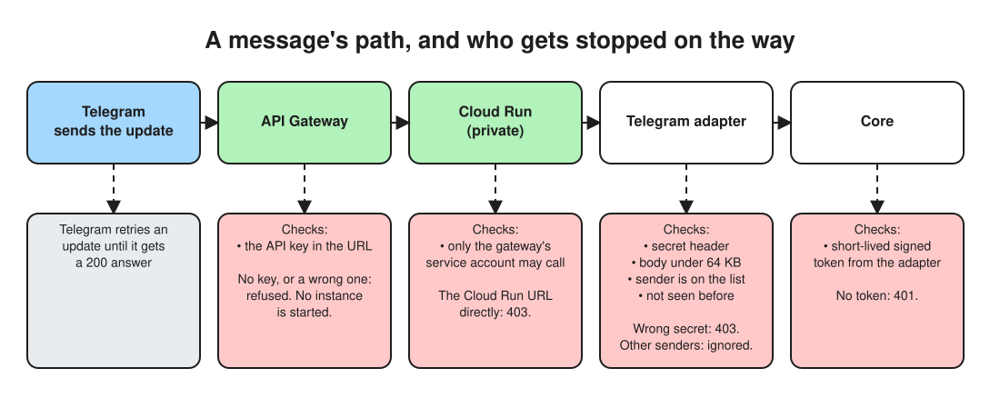
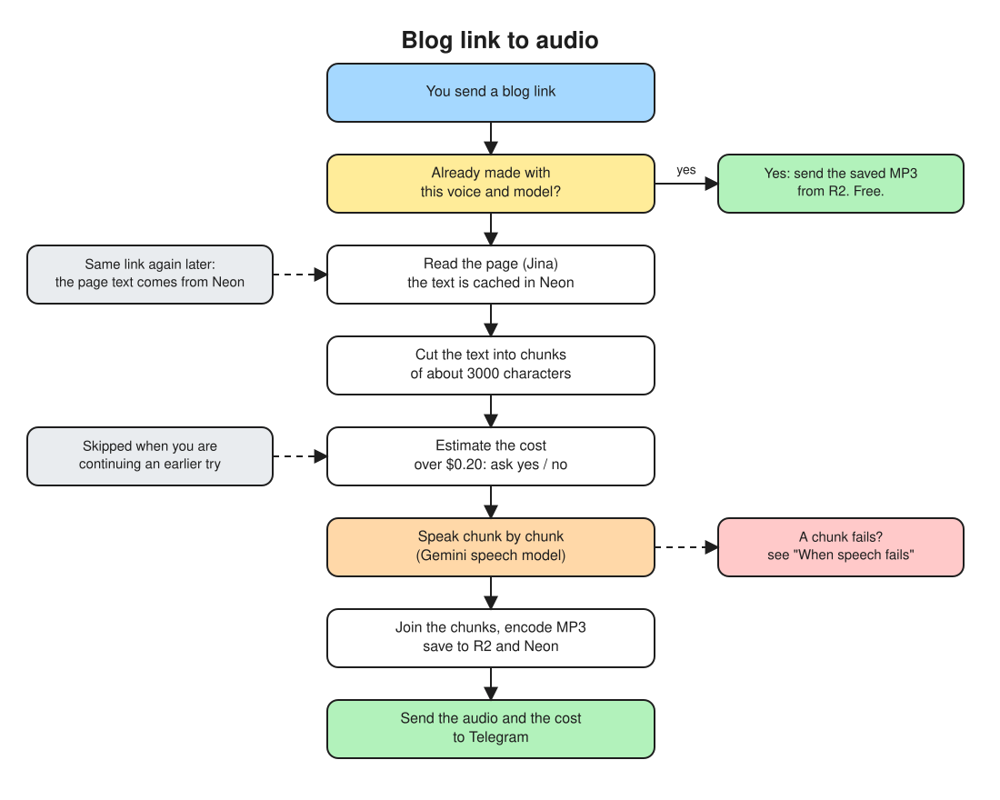
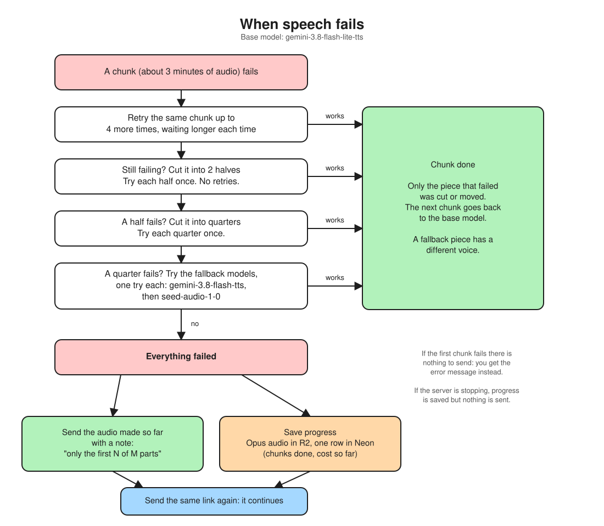
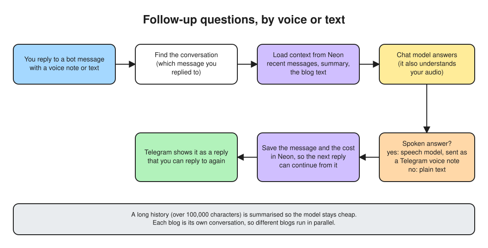
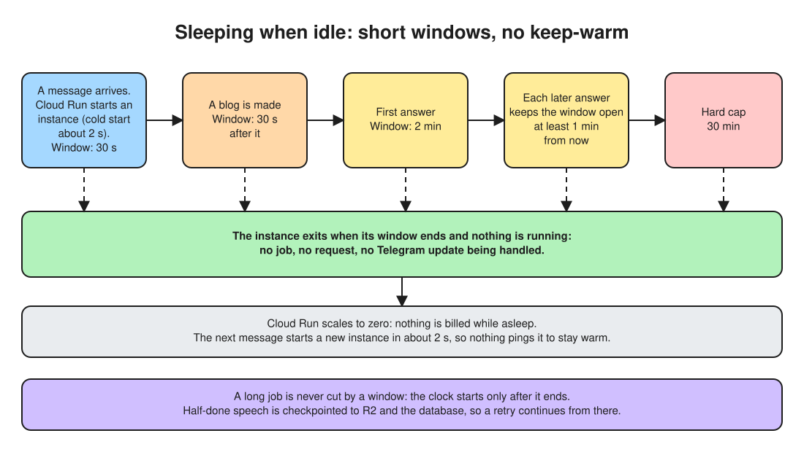
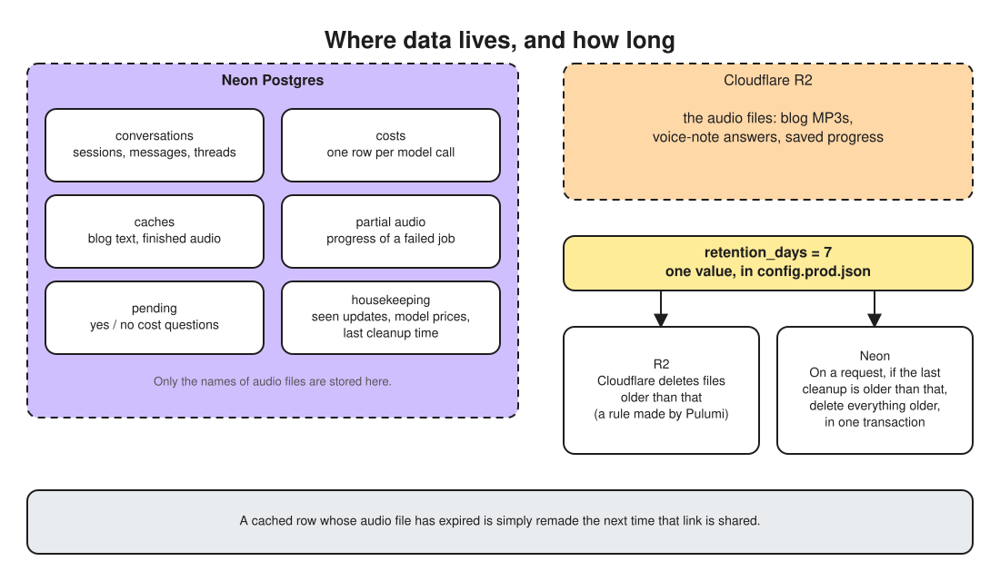
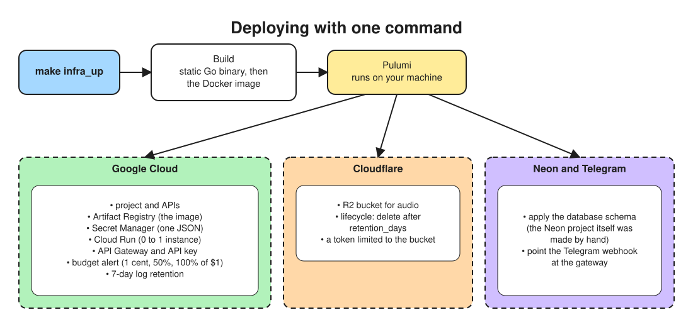

# sevi
- sevi is my extendable audio blog setup that I built to help me listen to blogs and interact with blogs online on the fly.
- I have lot of blogs to read but too little fixed time. so a flexible straightforward audio blog version of blog which can be cross questioned, debated and explore the tangents around the blog completely in audio format is what I wanted right now. so I built one.
- currently I extended sevi core with telegram interface coz it is easy for me to interact with telegram. it can be anything  whatsapp,discord,custom webpage. (custom webpage will be built for v1 for more fine grain features and usability)
- here is a quick demo of v1: https://drive.google.com/file/d/14Tp5XqHrz5HLR4dpEJ6m3DaxumOK2rU8/view?usp=sharing

- the overall infra can be lot simpler but Ive specifically designed it this way because none of it cost money, I took a bunch of primitives which have insanely high free limit and stritched them together which is fast and secure (I clearly understand the tradeoff but this is something personal that I use everyday so I am okay with it)

# Design (deployed version)

## 1. The big picture

## 2. A message's path, and who gets stopped on the way

## 3. Blog link to audio

## 4. When speech fails

A chunk is tried on the main voice model with the configured retries (`app.retries`), then cut into halves and quarters that are tried once each (no retries), and a quarter that still fails goes to the fallback models. After two chunks in a row fail on the main model it is skipped for 10 minutes. You can also reply `/stop` to a blog that is still being made: it stops at once and sends the audio made so far, and sending the link again continues from there.

## 5. Follow-up questions, by voice or text

## 6. Sleeping when idle

A cold start takes about 2 s, so the instance does not stay warm: it exits 30 s after a blog is delivered, and follow-up answers keep it up 1 to 2 minutes. A running job (audio generation can take many minutes) always finishes first; the window only starts counting once it ends.

## 7. Where data lives, and how long

## 8. Deploying

